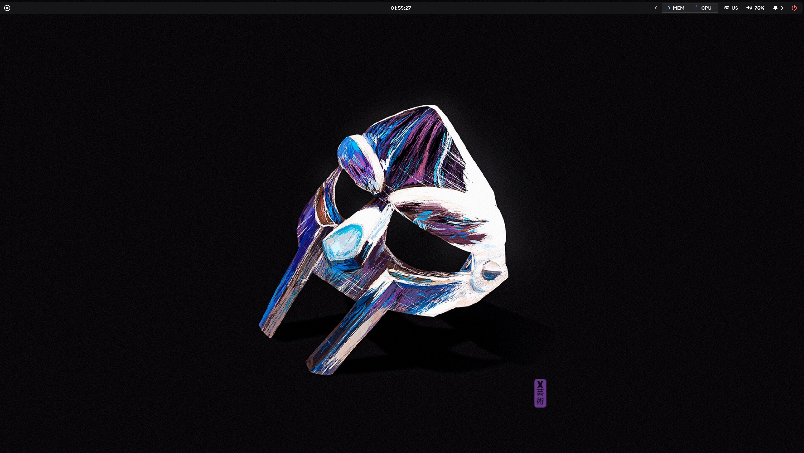
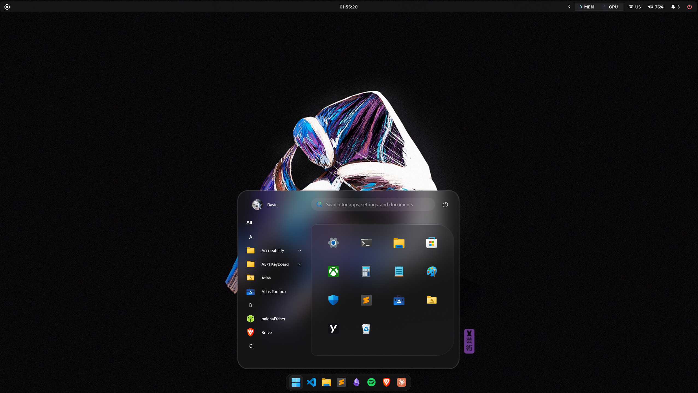
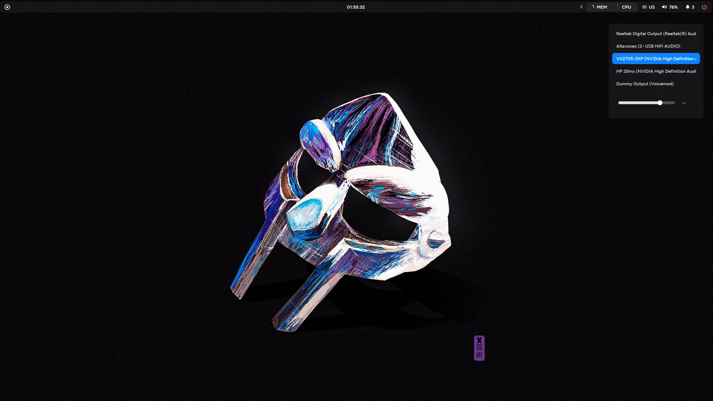
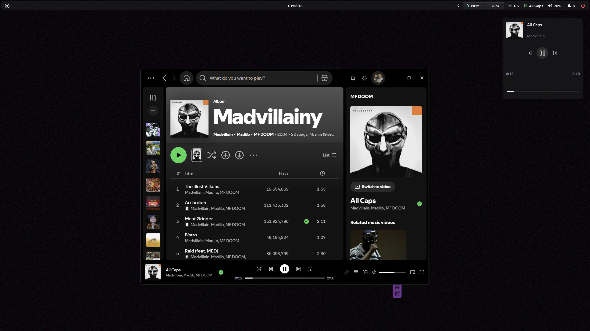
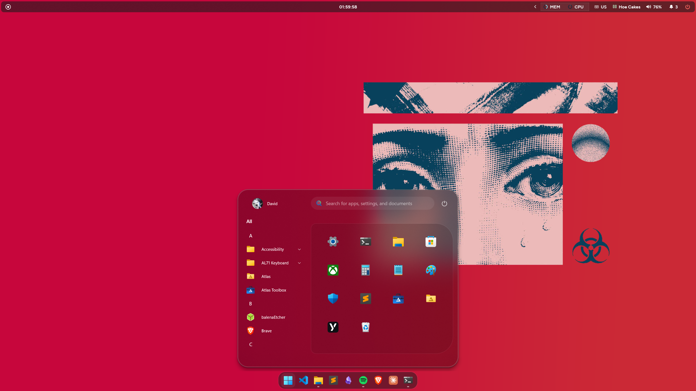

# windowsDesktopSetup

My Windows 11 desktop, reproducible with a single script: a macOS-style top bar with **YASB**, a taskbar / Start menu / notification center restyled with **Windhawk**, **macOS Tahoe** cursors, fonts and wallpapers.



## Screenshots

| Start menu (Windhawk) | Audio output selector (YASB) |
|---|---|
|  |  |

| Media widget (YASB) | With another wallpaper |
|---|---|
|  |  |

The top bar is YASB: Start button on the left, clock in the center and, on the right, the system tray, MEM/CPU usage, keyboard language, now playing, volume, notifications and the power menu. At the bottom, the Windows taskbar is centered and floating thanks to the Windhawk mods.

## Installation

```powershell
git clone https://github.com/DavidEguaras/windowsDesktopSetup.git
cd windowsDesktopSetup
Set-ExecutionPolicy -Scope Process Bypass -Force
.\install.ps1
```

The script relaunches itself as administrator (Windhawk stores its mods in `HKLM` and `ProgramData`). Before overwriting anything, it makes a backup in `%USERPROFILE%\windowsDesktopSetup-backup\<date>`.

During installation it asks whether you want to download the wallpapers folder.

To skip steps:

```powershell
.\install.ps1 -Skip apps,wallpapers
```

Available steps: `apps`, `fonts`, `yasb`, `windhawk`, `cursors`, `wallpapers`, `theme`.

## What it does

| Step | Details |
|---|---|
| `apps` | Installs [YASB](https://github.com/amnweb/yasb), [Windhawk](https://windhawk.net) and Git with `winget` |
| `fonts` | Installs **Figtree** (included in the repo) and **JetBrainsMono Nerd Font** (downloaded from nerd-fonts) for the current user |
| `yasb` | Copies `config.yaml` and `styles.css` to `~/.config/yasb` and adds YASB to Windows startup |
| `windhawk` | Restores the mods' source code, the compiled binaries and their settings (`mods.reg`) |
| `cursors` | Copies the macOS Tahoe cursors, applies them and registers them as the "macOS Tahoe" scheme |
| `wallpapers` | Asks first and, if you accept, clones [DavidEguaras/wallpapers](https://github.com/DavidEguaras/wallpapers) into `Pictures\wallpapers` and sets the wallpaper |
| `theme` | Dark mode + transparency |

## Windhawk mods

| Mod | Status |
|---|---|
| Windows 11 Taskbar Styler | enabled |
| Windows 11 Start Menu Styler | enabled |
| Windows 11 Notification Center Styler | enabled |
| Taskbar height and icon size | enabled |
| Taskbar auto-hide speed | enabled |
| Slick Window Arrangement | disabled |

## Structure

```
install.ps1                 install script
yasb/                       config.yaml + styles.css
windhawk/mods-source/       mod source code (.wh.cpp)
windhawk/compiled/          compiled mods (32 and 64 bit)
windhawk/mods.reg           settings for each mod
cursors/macos-tahoe/        cursors (.cur / .ani)
fonts/figtree/              Figtree font
screenshots/                README screenshots
```

## Notes

- The YASB weather widget reads `YASB_WEATHER_API_KEY` and `YASB_WEATHER_LOCATION` from environment variables; set them if you want to use it.
- If a Windhawk mod doesn't load after installing (for example, after updating Windhawk), open Windhawk and recompile it from the mod's page.
- The cursors come from the *macOS Tahoe Cursor (With Shadow)* pack by its author; they are included only to make reinstalling easier.
